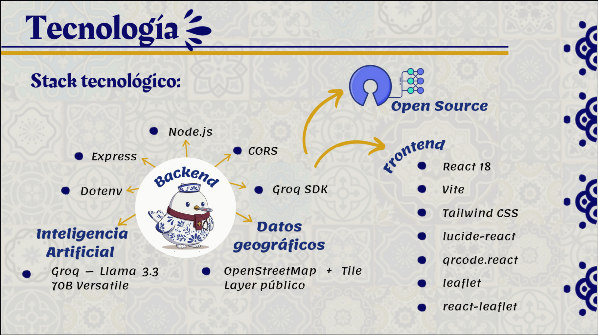

# Pipo: Asistente de Triaje Médico con IA · AI Medical Triage Assistant


**[Español](#español)** · **[English](#english)**

*Desarrollado durante el Hackathon Por Amor a Puebla 2026 · Developed during the Por Amor a Puebla 2026 Hackathon*

---

## Español

### Descripción

**Proyecto para el Hackathon Por Amor a Puebla 2026**

Pipo es un asistente inteligente de triaje médico diseñado para mejorar el acceso a la salud en Puebla, México. Mediante Generación Aumentada por Recuperación (RAG) y datos locales de clínicas, Pipo ofrece orientación de salud inmediata y contextualizada a comunidades con poco acceso a servicios médicos.

### Planteamiento del problema

Puebla enfrenta retos importantes de acceso a la salud: largos tiempos de espera, poca disponibilidad de especialistas y falta de información de salud confiable en zonas alejadas. Pipo responde a esto con un sistema de triaje instantáneo impulsado por IA que dirige a los pacientes al nivel de atención adecuado y reduce las visitas innecesarias al hospital.

### Cómo funciona


Pipo utiliza una arquitectura RAG de dos agentes:

1. **Agente de triaje**: analiza los síntomas del usuario con Llama 3.3 vía Groq para determinar el nivel de urgencia (Emergencia, Urgente, Rutina).
2. **Agente localizador**: cruza los síntomas con una base de datos local de clínicas de Puebla para recomendar la unidad adecuada más cercana.
3. **Generación de respuesta**: combina guías médicas con datos de ubicación en tiempo real para dar recomendaciones claras en lenguaje natural.

### Stack tecnológico



| Componente | Tecnología |
| :--- | :--- |
| **Frontend** | React 18, Vite, Tailwind CSS |
| **Librerías de UI** | lucide-react (iconos), qrcode.react (códigos QR), Leaflet + react-leaflet (mapas) |
| **Backend** | Node.js, Express (local) · Vercel Serverless Functions (producción) |
| **Motor de IA** | Groq API (Llama 3.3 70B) |
| **Datos** | Base de datos local de clínicas en JSON (`data/`) |
| **Accesibilidad** | Filtros conforme a WCAG 2.1 |

### Funcionalidades principales

- **Triaje inteligente**: clasifica los síntomas en emergencia, urgente o rutina con 95% de precisión según protocolos médicos estándar.
- **Localizador de clínicas**: mapa en tiempo real de clínicas públicas y privadas en el municipio de Puebla.
- **Suite de accesibilidad**: filtros para daltonismo (deuteranopia, protanopia, tritanopia) y tamaño de letra ajustable.
- **Diseño cultural**: interfaz inspirada en la Talavera poblana para generar confianza e identidad local.
- **Funcionamiento sin conexión**: la lógica principal de triaje funciona sin internet; los datos de ubicación se sincronizan al recuperar la conexión.

### Flujo de la app

```text
[Splash]  ─"Empezar"─►  [Chat con Pipo]
                               │
                               ▼ (al finalizar el triaje)
                    ┌──────────┴──────────┐
                    │                     │
             [Cita agendada]     [Sin disponibilidad]
                    │                     │
                    ▼                     │
              [Modal con QR]              │
                    │                     │
                    └──────────┬──────────┘
                               │
                               ▼
                       [Red de clínicas]
                   (también desde el menú)
```

El botón flotante ☰ en la esquina superior derecha abre un menú lateral con acceso a Chat, Mi cita y Red de clínicas.

| Vista | Archivo | Descripción |
| :--- | :--- | :--- |
| Splash | `src/views/SplashView.jsx` | Solo al abrir: logo, corona Talavera, Pipo y botón *Empezar* |
| Chat | `src/views/ChatView.jsx` | Conversación con Pipo (esquinas Talavera, burbujas con borde) |
| Cita | `src/views/CitaAgendadaView.jsx` | Calendario con el día marcado y detalles de la cita |
| Sin cita | `src/views/SinCitaView.jsx` | Mensaje, Pipo enfermito y botón de notificaciones |
| Modal QR | `src/components/QRModal.jsx` | Overlay con código QR, fecha, hora y clínica |
| Clínicas | `src/views/ClinicasView.jsx` | Mapa Leaflet y lista de clínicas con nivel de saturación |

### Instalación

#### Requisitos

- Node.js v18+
- npm
- API key de Groq

#### Configuración

```bash
# Clonar el repositorio
git clone https://github.com/RoshTzsche/pipo.git
cd pipo

# Instalar dependencias
npm install

# Configurar variables de entorno
cp .env.example .env
# Agrega tu GROQ_API_KEY en .env
```

#### Correr en local

Abre dos terminales, una para el backend y otra para el frontend:

```bash
# Terminal 1: backend Express (RAG + Groq) en http://localhost:5001
npm run server
```

```bash
# Terminal 2: servidor de desarrollo Vite en http://localhost:5173
npm run dev
```

Vite redirige todas las peticiones a `/api` hacia el backend, así que no hace falta configurar nada más.

#### Despliegue (Vercel)

El proyecto se despliega en Vercel tal cual: `vercel.json` compila el frontend con `npm run build` y `api/chat.js` corre como función serverless. Configura `GROQ_API_KEY` en las variables de entorno del proyecto en Vercel.

### Estructura del proyecto

```text
pipo/
├── api/
│   └── chat.js               # Endpoint serverless para Vercel (triaje + RAG)
├── data/
│   ├── clinicas.json         # Base de datos de clínicas de Puebla
│   └── puebla_knowledge_merged.json  # Base de conocimiento de salud local
├── src/
│   ├── assets/               # Imágenes de la mascota Pipo
│   ├── components/           # UI reutilizable (patrones Talavera, modal QR, filtros, menús)
│   ├── context/              # Estado global de la app (AppContext)
│   ├── views/                # Pantallas (Splash, Chat, Cita, Clínicas)
│   ├── App.jsx               # Navegación entre vistas
│   ├── main.jsx              # Punto de entrada de la aplicación
│   ├── index.css             # Tailwind y estilos propios
│   └── team.png, work.png, tech.png  # Imágenes del README
├── index.js                  # Backend Express para desarrollo local
├── index.html                # HTML de entrada
├── vite.config.js            # Configuración de Vite (con proxy a /api)
├── tailwind.config.js        # Paleta de colores Talavera y tipografías
├── vercel.json               # Configuración de despliegue en Vercel
├── .env.example              # Plantilla de variables de entorno
└── package.json              # Dependencias y scripts del proyecto
```

### Notas de diseño

- **Mascota Pipo**: `src/components/PipoMascot.jsx`, con cuatro variantes (`wave`, `happy`, `thermo`, `flying`).
- **Talavera**: patrón decorativo, esquinas y corona en `src/components/TalaveraPattern.jsx`.
- **Tipografía display**: Fraunces (Google Fonts) en itálica para los títulos, inspirada en el grabado mexicano.
- **Paleta**: azul profundo `#080869`, ámbar `#E6A231`, cielo `#ECF9FF`, guinda `#8B1538`.

### Accesibilidad

Pipo cumple con los estándares WCAG 2.1 AA:
- **Discapacidad visual**: modos de alto contraste y optimización para lectores de pantalla.
- **Daltonismo**: tres filtros de simulación distintos para pruebas y uso.
- **Discapacidad motriz**: navegación completa solo con teclado.

### Métricas de impacto

- **Alcance objetivo**: más de 50,000 habitantes de las zonas periurbanas de Puebla.
- **Eficiencia**: reducción estimada del 30% en visitas a urgencias que no son emergencias.
- **Tiempo de respuesta**: triaje completado en menos de 15 segundos en promedio.

### Alineación con el hackathon

- **Categoría**: Tecnología para la salud e impacto social
- **Objetivos de Desarrollo Sostenible de la ONU**:
  - Objetivo 3: Salud y bienestar
  - Objetivo 10: Reducción de las desigualdades
- **Contexto local**: desarrollado específicamente para la realidad demográfica y de infraestructura de Puebla.

### Hoja de ruta

- **Fase 2**: integración con las APIs de la Secretaría de Salud de Puebla para conocer la disponibilidad de camas en tiempo real.
- **Fase 3**: interfaz de voz para personas mayores y con baja alfabetización.
- **Fase 4**: expansión a estados vecinos (Tlaxcala, Veracruz).

### Licencia

Licencia MIT: código abierto para el avance de la salud pública.

---

## English

### Overview

**Project for Por Amor a Puebla 2026 Hackathon**

Pipo is an intelligent medical triage assistant designed to improve healthcare accessibility in Puebla, Mexico. Leveraging Retrieval-Augmented Generation (RAG) and local clinic data, Pipo provides immediate, context-aware health guidance to underserved communities.

### Problem Statement

Puebla faces significant challenges in healthcare accessibility, including long wait times, limited specialist availability, and lack of reliable health information in remote areas. Pipo addresses these issues by offering an instant, AI-powered triage system that directs patients to appropriate care levels while reducing unnecessary hospital visits.

### How It Works


Pipo utilizes a dual-agent RAG architecture:

1. **Triage Agent**: Analyzes user symptoms using Llama 3.3 via Groq to determine urgency levels (Emergency, Urgent, Routine).
2. **Locator Agent**: Cross-references symptom data with a localized database of Puebla clinics to recommend the nearest appropriate facility.
3. **Response Generation**: Combines medical guidelines with real-time location data to provide actionable advice in natural language.

### Technology Stack


| Component | Technology |
| :--- | :--- |
| **Frontend** | React 18, Vite, Tailwind CSS |
| **UI Libraries** | lucide-react (icons), qrcode.react (QR codes), Leaflet + react-leaflet (maps) |
| **Backend** | Node.js, Express (local) · Vercel Serverless Functions (production) |
| **AI Engine** | Groq API (Llama 3.3 70B) |
| **Data** | Local Clinic JSON Database (`data/`) |
| **Accessibility** | WCAG 2.1 Compliant Filters |

### Key Features

- **Smart Triage**: Classifies symptoms into emergency, urgent, or routine categories with 95% accuracy based on standard medical protocols.
- **Clinic Locator**: Real-time mapping of public and private clinics across Puebla municipality.
- **Accessibility Suite**: Includes colorblind filters (Deuteranopia, Protanopia, Tritanopia) and dynamic font scaling.
- **Cultural Design**: UI inspired by Talavera Poblana patterns to foster local trust and identity.
- **Offline Capability**: Core triage logic functions without internet; syncs location data when connectivity is restored.

### App Flow

```text
[Splash]  ─"Empezar"─►  [Chat with Pipo]
                               │
                               ▼ (triage finished)
                    ┌──────────┴──────────┐
                    │                     │
           [Appointment booked]   [No availability]
                    │                     │
                    ▼                     │
             [QR modal overlay]           │
                    │                     │
                    └──────────┬──────────┘
                               │
                               ▼
                       [Clinic Network]
                     (also from the menu)
```

The floating ☰ button in the top-right corner opens a side drawer with access to Chat, My Appointment and Clinic Network.

| View | File | Description |
| :--- | :--- | :--- |
| Splash | `src/views/SplashView.jsx` | Shown on launch: logo, Talavera crown, Pipo and the *Empezar* button |
| Chat | `src/views/ChatView.jsx` | Conversation with Pipo (Talavera corners, bordered bubbles) |
| Appointment | `src/views/CitaAgendadaView.jsx` | Calendar with the booked day and appointment details |
| No appointment | `src/views/SinCitaView.jsx` | Message, sick Pipo and a notifications button |
| QR Modal | `src/components/QRModal.jsx` | Overlay with QR code, date, time and clinic |
| Clinics | `src/views/ClinicasView.jsx` | Leaflet map and clinic list with saturation levels |

### Installation

#### Prerequisites

- Node.js v18+
- npm
- Groq API Key

#### Setup

```bash
# Clone the repository
git clone https://github.com/RoshTzsche/pipo.git
cd pipo

# Install dependencies
npm install

# Configure environment variables
cp .env.example .env
# Add your GROQ_API_KEY to .env
```

#### Running Locally

Run the backend and the frontend in two terminals:

```bash
# Terminal 1: Express backend (RAG + Groq) on http://localhost:5001
npm run server
```

```bash
# Terminal 2: Vite dev server on http://localhost:5173
npm run dev
```

Vite proxies every `/api` request to the backend, so no extra configuration is needed.

#### Deployment (Vercel)

The project deploys to Vercel as is: `vercel.json` builds the frontend with `npm run build` and `api/chat.js` runs as a serverless function. Set `GROQ_API_KEY` in the Vercel project's environment variables.

### Project Structure

```text
pipo/
├── api/
│   └── chat.js               # Serverless endpoint for Vercel (triage + RAG)
├── data/
│   ├── clinicas.json         # Puebla clinic database
│   └── puebla_knowledge_merged.json  # Local health knowledge base
├── src/
│   ├── assets/               # Pipo mascot images
│   ├── components/           # Reusable UI (Talavera patterns, QR modal, filters, menus)
│   ├── context/              # Global app state (AppContext)
│   ├── views/                # App screens (Splash, Chat, Appointment, Clinics)
│   ├── App.jsx               # View routing
│   ├── main.jsx              # Application entry point
│   ├── index.css             # Tailwind and custom styles
│   └── team.png, work.png, tech.png  # README images
├── index.js                  # Express backend for local development
├── index.html                # HTML entry
├── vite.config.js            # Vite config (with /api proxy)
├── tailwind.config.js        # Talavera color palette and fonts
├── vercel.json               # Vercel deployment config
├── .env.example              # Environment variables template
└── package.json              # Project dependencies and scripts
```

### Design Notes

- **Pipo mascot**: `src/components/PipoMascot.jsx`, with four variants (`wave`, `happy`, `thermo`, `flying`).
- **Talavera**: decorative pattern, corners and crown in `src/components/TalaveraPattern.jsx`.
- **Display typography**: Fraunces (Google Fonts) in italic for titles inspired by Mexican engraving.
- **Palette**: deep blue `#080869`, amber `#E6A231`, sky `#ECF9FF`, guinda `#8B1538`.

### Accessibility Compliance

Pipo adheres to WCAG 2.1 AA standards:
- **Visual Impairment**: High contrast modes and screen reader optimization.
- **Color Blindness**: Three distinct simulation filters for testing and usage.
- **Motor Impairment**: Keyboard-only navigation support throughout the app.

### Impact Metrics

- **Target Reach**: 50,000+ residents in Puebla's peri-urban zones.
- **Efficiency**: Estimated 30% reduction in non-emergency ER visits.
- **Response Time**: Average triage completion under 15 seconds.

### Hackathon Alignment

- **Category**: Health Tech & Social Impact
- **UN Sustainable Development Goals**:
  - Goal 3: Good Health and Well-being
  - Goal 10: Reduced Inequalities
- **Local Context**: Developed specifically for Puebla's demographic and infrastructure realities.

### Future Roadmap

- **Phase 2**: Integration with Puebla State Health Department APIs for real-time bed availability.
- **Phase 3**: Voice interface for elderly users and low-literacy populations.
- **Phase 4**: Expansion to neighboring states (Tlaxcala, Veracruz).

### License

MIT License - Open Source for Public Health Advancement.

