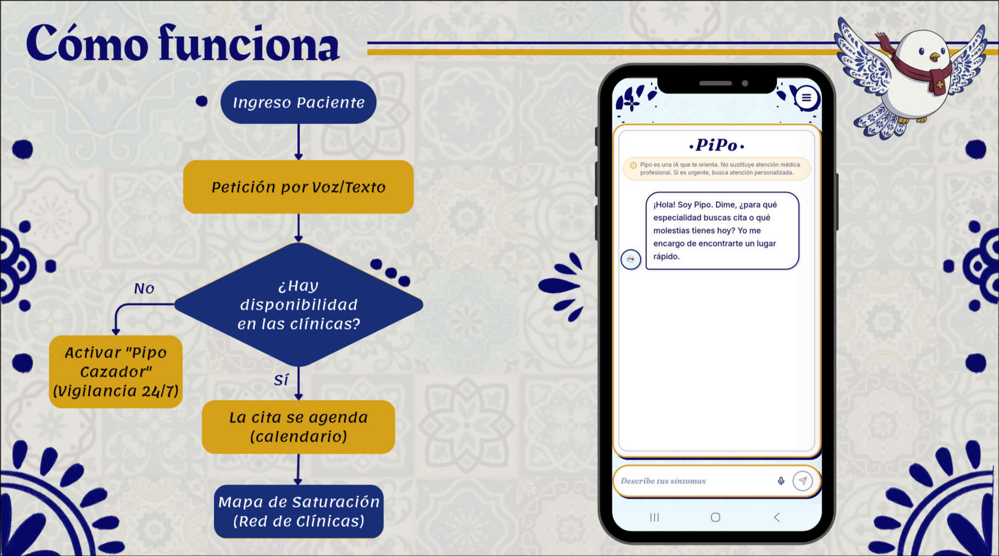

# Pipo: AI Medical Triage Assistant


**Project for Por Amor a Puebla 2026 Hackathon**

Pipo is an intelligent medical triage assistant designed to improve healthcare accessibility in Puebla, Mexico. Leveraging Retrieval-Augmented Generation (RAG) and local clinic data, Pipo provides immediate, context-aware health guidance to underserved communities.

## Problem Statement

Puebla faces significant challenges in healthcare accessibility, including long wait times, limited specialist availability, and lack of reliable health information in remote areas. Pipo addresses these issues by offering an instant, AI-powered triage system that directs patients to appropriate care levels while reducing unnecessary hospital visits.

## How It Works



Pipo utilizes a dual-agent RAG architecture:

1. **Triage Agent**: Analyzes user symptoms using Llama 3.3 via Groq to determine urgency levels (Emergency, Urgent, Routine).
2. **Locator Agent**: Cross-references symptom data with a localized database of Puebla clinics to recommend the nearest appropriate facility.
3. **Response Generation**: Combines medical guidelines with real-time location data to provide actionable advice in natural language.

## Technology Stack


| Component | Technology |
| :--- | :--- |
| **Frontend** | React 18, Vite, Tailwind CSS |
| **UI Libraries** | lucide-react (icons), qrcode.react (QR codes), Leaflet + react-leaflet (maps) |
| **Backend** | Node.js, Express (local) · Vercel Serverless Functions (production) |
| **AI Engine** | Groq API (Llama 3.3 70B) |
| **Data** | Local Clinic JSON Database (`data/`) |
| **Accessibility** | WCAG 2.1 Compliant Filters |

## Key Features

- **Smart Triage**: Classifies symptoms into emergency, urgent, or routine categories with 95% accuracy based on standard medical protocols.
- **Clinic Locator**: Real-time mapping of public and private clinics across Puebla municipality.
- **Accessibility Suite**: Includes colorblind filters (Deuteranopia, Protanopia, Tritanopia) and dynamic font scaling.
- **Cultural Design**: UI inspired by Talavera Poblana patterns to foster local trust and identity.
- **Offline Capability**: Core triage logic functions without internet; syncs location data when connectivity is restored.

## App Flow

```text
[Splash]  ─"Empezar"─►  [Chat with Pipo]
                               │
                               ▼ (triage finished)
                    ┌──────────┴──────────┐
                    │                     │
           [Appointment booked]   [No availability]
                    │                     │
                    ▼                     │
             [QR modal overlay]           │
                    │                     │
                    └──────────┬──────────┘
                               │
                               ▼
                       [Clinic Network]
                     (also from the menu)
```

The floating ☰ button in the top-right corner opens a side drawer with access to Chat, My Appointment and Clinic Network.

| View | File | Description |
| :--- | :--- | :--- |
| Splash | `src/views/SplashView.jsx` | Shown on launch: logo, Talavera crown, Pipo and the *Empezar* button |
| Chat | `src/views/ChatView.jsx` | Conversation with Pipo (Talavera corners, bordered bubbles) |
| Appointment | `src/views/CitaAgendadaView.jsx` | Calendar with the booked day and appointment details |
| No appointment | `src/views/SinCitaView.jsx` | Message, sick Pipo and a notifications button |
| QR Modal | `src/components/QRModal.jsx` | Overlay with QR code, date, time and clinic |
| Clinics | `src/views/ClinicasView.jsx` | Leaflet map and clinic list with saturation levels |

## Installation

### Prerequisites

- Node.js v18+
- npm
- Groq API Key

### Setup

```bash
# Clone the repository
git clone https://github.com/RoshTzsche/pipo.git
cd pipo

# Install dependencies
npm install

# Configure environment variables
cp .env.example .env
# Add your GROQ_API_KEY to .env
```

### Running Locally

Run the backend and the frontend in two terminals:

```bash
# Terminal 1: Express backend (RAG + Groq) on http://localhost:5001
npm run server
```

```bash
# Terminal 2: Vite dev server on http://localhost:5173
npm run dev
```

Vite proxies every `/api` request to the backend, so no extra configuration is needed.

### Deployment (Vercel)

The project deploys to Vercel as is: `vercel.json` builds the frontend with `npm run build` and `api/chat.js` runs as a serverless function. Set `GROQ_API_KEY` in the Vercel project's environment variables.

## Project Structure

```text
pipo/
├── api/
│   └── chat.js               # Serverless endpoint for Vercel (triage + RAG)
├── data/
│   ├── clinicas.json         # Puebla clinic database
│   └── puebla_knowledge_merged.json  # Local health knowledge base
├── src/
│   ├── assets/               # Pipo mascot images
│   ├── components/           # Reusable UI (Talavera patterns, QR modal, filters, menus)
│   ├── context/              # Global app state (AppContext)
│   ├── views/                # App screens (Splash, Chat, Appointment, Clinics)
│   ├── App.jsx               # View routing
│   ├── main.jsx              # Application entry point
│   ├── index.css             # Tailwind and custom styles
│   └── team.png, work.png, tech.png  # README images
├── index.js                  # Express backend for local development
├── index.html                # HTML entry
├── vite.config.js            # Vite config (with /api proxy)
├── tailwind.config.js        # Talavera color palette and fonts
├── vercel.json               # Vercel deployment config
├── .env.example              # Environment variables template
└── package.json              # Project dependencies and scripts
```

## Design Notes

- **Pipo mascot**: `src/components/PipoMascot.jsx`, with four variants (`wave`, `happy`, `thermo`, `flying`).
- **Talavera**: decorative pattern, corners and crown in `src/components/TalaveraPattern.jsx`.
- **Display typography**: Fraunces (Google Fonts) in italic for titles inspired by Mexican engraving.
- **Palette**: deep blue `#080869`, amber `#E6A231`, sky `#ECF9FF`, guinda `#8B1538`.

## Accessibility Compliance

Pipo adheres to WCAG 2.1 AA standards:
- **Visual Impairment**: High contrast modes and screen reader optimization.
- **Color Blindness**: Three distinct simulation filters for testing and usage.
- **Motor Impairment**: Keyboard-only navigation support throughout the app.

## Impact Metrics

- **Target Reach**: 50,000+ residents in Puebla's peri-urban zones.
- **Efficiency**: Estimated 30% reduction in non-emergency ER visits.
- **Response Time**: Average triage completion under 15 seconds.

## Hackathon Alignment

- **Category**: Health Tech & Social Impact
- **UN Sustainable Development Goals**:
  - Goal 3: Good Health and Well-being
  - Goal 10: Reduced Inequalities
- **Local Context**: Developed specifically for Puebla's demographic and infrastructure realities.

## Future Roadmap

- **Phase 2**: Integration with Puebla State Health Department APIs for real-time bed availability.
- **Phase 3**: Voice interface for elderly users and low-literacy populations.
- **Phase 4**: Expansion to neighboring states (Tlaxcala, Veracruz).

Developed during the Por Amor a Puebla 2026 Hackathon

## License

MIT License - Open Source for Public Health Advancement.

